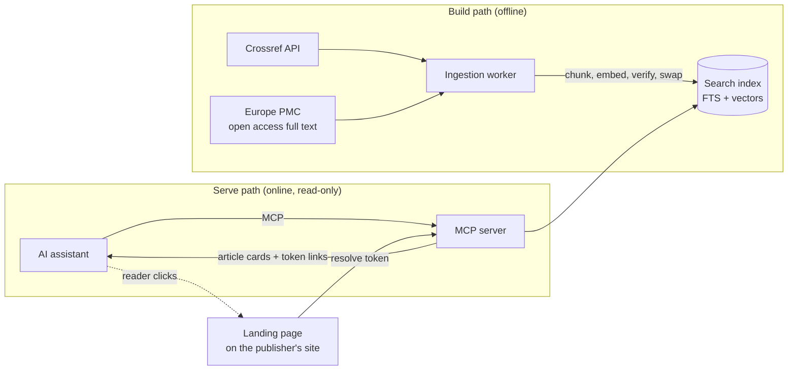

<div align="center">

# scholarly-mcp

**Turn AI assistants into a discovery channel for scholarly publishers.**

An MCP server that answers research questions with a short list of relevant articles,
each linking to a personalised landing page on the publisher's own site, never the article itself.

[](https://github.com/sami3ullah/scholarly_mcp/actions/workflows/ci.yml)


[Why](#why) · [How it works](#how-it-works) · [Tools](#tools) · [Quick start](#quick-start) · [Architecture](#architecture) · [Limitations](#limitations) · [Roadmap](#roadmap) · [Docs](#documentation)

</div>

> [!NOTE]
> Independent prototype, **not affiliated with Thieme** or any other publisher. It ships with a preset for
> Thieme's DOI prefix (`10.1055`) as a worked example and works with any Crossref prefix.

---

## Why

Clinicians and researchers increasingly ask AI assistants instead of visiting publisher sites. Several large
publishers already make their content reachable from these assistants. **scholarly-mcp** gives any publisher the
same reach while keeping readers, and the reading itself, on the publisher's site.

| Goal                         | What it means                                                                                                 |
| ---------------------------- | ------------------------------------------------------------------------------------------------------------- |
| 🔗 **Link-first results**    | Title, journal, year, a teaser of at most 280 characters and a link. No full text or whole abstracts in chat. |
| 🎯 **Personalised landing**  | Every click opens a page built for that search: the chosen article, other matches, the matched passage.       |
| 🌍 **Cross-language search** | A German query finds English papers, and the reverse.                                                         |
| 📦 **Zero-setup trial**      | One `docker run` with a prebuilt index. No database or API keys to set up.                                    |
| 🏭 **Production path**       | Postgres store adapter, plus a source adapter you point at your own content API.                              |
| 📈 **Measurable referrals**  | UTM tags plus a landing token tie every visit to the search that produced it, without storing query text.     |

## How it works



1. **Ask.** A reader asks their assistant a question, in German or English.
2. **Search.** The server runs lexical and semantic search in parallel and fuses them with Reciprocal Rank Fusion.
3. **Answer.** The assistant gets a few article cards: title, journal, year, a short teaser, why it matched, and a link.
4. **Click.** The link opens a landing page rebuilt from a short-lived token: no query text ever appears in the URL.

## Tools

Six read-only MCP tools. Every one returns article cards, never article content.

| Tool              | Purpose                                                             |
| ----------------- | ------------------------------------------------------------------- |
| `search_articles` | Hybrid search with language, journal, year and open access filters  |
| `get_article`     | One card for a known DOI                                            |
| `find_related`    | Nearest neighbours of an article                                    |
| `get_journal`     | Journal details and its page link                                   |
| `cite`            | Formatted citation (Vancouver, APA, AMA, BibTeX, RIS)               |
| `check_access`    | Open, subscription or institutional access, plus login or buy links |

<details>
<summary><b>What an article card looks like</b></summary>

```json
{
  "title": "Current Evidence on Local Therapies in Advanced Adrenocortical Carcinoma",
  "journal": "Hormone and Metabolic Research",
  "year": 2024,
  "firstAuthor": "Kimpel",
  "teaser": "At most 280 characters, cut at a word boundary…",
  "whyMatched": "matched in Results: local therapy",
  "access": "open",
  "url": "https://…/mcp/landing?t=<token>&doi=10.1055/a-2209-6022&utm_source=mcp&utm_medium=ai&utm_campaign=search_articles",
  "doi": "10.1055/a-2209-6022",
  "notice": "Evidence pointers, not clinical advice. Independent prototype, not affiliated with Thieme."
}
```

</details>

> [!IMPORTANT]
> The tools are being built. See the [roadmap](#roadmap) for what works today.

## Quick start

### Try it (coming in SM-14)

```bash
docker run -p 3000:3000 ghcr.io/sami3ullah/scholarly_mcp   # prebuilt index, demo API key
```

### Develop

Requirements: **Node 24 LTS** (via [nvm](https://github.com/nvm-sh/nvm)), **pnpm 10** (via corepack), Docker for the image and Postgres tests.

```bash
git clone https://github.com/sami3ullah/scholarly_mcp.git
cd scholarly_mcp
nvm use && corepack enable
pnpm install
pnpm check        # format, lint, typecheck, layering rules, tests with coverage
```

<details>
<summary><b>All scripts</b></summary>

| Script                                    | What it does                                                          |
| ----------------------------------------- | --------------------------------------------------------------------- |
| `pnpm check`                              | Everything CI runs, in order                                          |
| `pnpm test`                               | Unit and contract tests (Vitest)                                      |
| `pnpm test:coverage`                      | Tests with the 85% coverage gate                                      |
| `pnpm lint`                               | ESLint, strict and type-aware                                         |
| `pnpm typecheck`                          | `tsc` across all packages (Turborepo)                                 |
| `pnpm depcruise`                          | Enforces the layering rules between packages                          |
| `pnpm format`                             | Prettier                                                              |
| `pnpm ingest <full\|incremental\|verify>` | Build, refresh or check the index ([guide](docs/guides/ingestion.md)) |

</details>

## Architecture

Ports and adapters: the core knows nothing about Crossref, SQLite or Postgres, so each can be swapped without
touching search or the tools.

```
scholarly-mcp/
├── packages/
│   ├── core/              domain types, zod schemas, ports, search + RRF, article cards
│   ├── source-crossref/   Crossref adapter (metadata, abstracts, licenses)
│   ├── source-europepmc/  open access full text, used for matching only
│   ├── store-sqlite/      FTS5 + trigram + sqlite-vec, landing sessions
│   ├── store-postgres/    tsvector + pgvector, migrations
│   ├── embedder-onnx/     multilingual-e5-small via transformers.js
│   ├── logger/            pino logger with query and secret redaction
│   └── testkit/           contract suites, fixtures, golden set
├── apps/
│   ├── ingest/            CLI: full, incremental, verify
│   ├── server/            MCP server: tools, auth, metering, health
│   └── landing/           Next.js reference landing page
└── docs/                  plan, ADRs, guides
```

| Layer            | Swappable via  | Default                           | Production                     |
| ---------------- | -------------- | --------------------------------- | ------------------------------ |
| Content source   | `Source`       | Crossref + Europe PMC             | Your content API               |
| Search index     | `Store`        | SQLite (FTS5 + sqlite-vec)        | Postgres (tsvector + pgvector) |
| Embeddings       | `Embedder`     | multilingual-e5-small, in-process | Any 384-dim model              |
| Landing sessions | `SessionStore` | SQLite                            | Postgres                       |
| Access status    | `Entitlements` | Mock                              | Your entitlement service       |
| Usage events     | `Meter`        | JSON lines + webhook              | Your billing pipeline          |

Read more in the [engineering plan](docs/PLAN.md#high-level-architecture) and the [ADRs](docs/adr/README.md).

## Guardrails

- **Official APIs only** (Crossref, Europe PMC). No scraping.
- **No article content in chat** beyond a 280-character teaser.
- **No query text** in URLs, logs or stores. A clinician may type patient details; we never keep them.
- **Retracted papers** are excluded by default and flagged when fetched directly.
- **Not clinical advice.** Every response carries a notice; the server never generates answers.
- **Open access full text is for matching only.** CC BY and CC BY-NC-ND text helps ranking but is never shown or exported ([ADR 0003](docs/adr/0003-cc-by-nc-nd-full-text-for-matching-only.md)).

## Limitations

| Limitation                                                                                                                                                                                                                                                                                                                                                                    | Impact                                                                                                 | Fix                                                                    |
| ----------------------------------------------------------------------------------------------------------------------------------------------------------------------------------------------------------------------------------------------------------------------------------------------------------------------------------------------------------------------------- | ------------------------------------------------------------------------------------------------------ | ---------------------------------------------------------------------- |
| **Crossref public pool.** No contact email is configured, so ingestion uses Crossref's slower public pool instead of the polite pool ([ADR 0005](docs/adr/0005-crossref-public-pool.md)).                                                                                                                                                                                     | The first full ingestion is slower and sees more rate limiting. Incremental syncs are barely affected. | Set `CROSSREF_MAILTO`.                                                 |
| **Thin abstracts.** About half of recent Thieme articles have no abstract in Crossref.                                                                                                                                                                                                                                                                                        | Those articles match on title, journal and subjects only.                                              | Open access full text helps; a publisher's own content API removes it. |
| **Coarse subjects for some articles.** Crossref has no subjects; Europe PMC covers only part of the corpus ([ADR 0004](docs/adr/0004-subjects-from-europe-pmc.md)).                                                                                                                                                                                                           | Articles outside Europe PMC get journal-level subjects.                                                | A publisher's own taxonomy via a source adapter.                       |
| **Embargoes open on a full run.** An article whose open licence starts in the future is indexed as closed; incremental runs skip unchanged records, so it opens at the next full run, which `ingest incremental` triggers every 7 days by default ([ADR 0020](docs/adr/0020-crossref-source-ingestion-rules.md), [ADR 0022](docs/adr/0022-sqlite-index-files-and-builds.md)). | Until then it shows as paywalled, with the abstract and a subscribe link.                              |
| **Early development.** Most tools are not built yet.                                                                                                                                                                                                                                                                                                                          | See the roadmap.                                                                                       | -                                                                      |

## Roadmap

| Ticket                                            | Scope                                                | Status |
| ------------------------------------------------- | ---------------------------------------------------- | :----: |
| [SM-00](tickets/SM-00-feasibility-spike.md)       | Feasibility spike ([results](docs/spike-results.md)) |   ✅   |
| [SM-01](tickets/SM-01-foundations.md)             | Monorepo foundations and CI                          |   ✅   |
| [SM-02](tickets/SM-02-core-domain.md)             | Core domain, ports, config, errors, testkit          |   ✅   |
| [SM-03](tickets/SM-03-crossref-source.md)         | Crossref source and normalisation                    |   ✅   |
| [SM-04](tickets/SM-04-chunker-embedder.md)        | Chunker and ONNX embedder                            |   ✅   |
| [SM-05](tickets/SM-05-sqlite-store-ingest.md)     | SQLite store and ingest CLI                          |   ✅   |
| [SM-06](tickets/SM-06-europepmc-source.md)        | Europe PMC full-text source                          |   ⬜   |
| [SM-07](tickets/SM-07-search-service.md)          | Search service                                       |   ⬜   |
| [SM-08](tickets/SM-08-golden-set-eval.md)         | Golden set, eval and tuning                          |   ⬜   |
| [SM-09](tickets/SM-09-mcp-server.md)              | MCP server: six tools and transports                 |   ⬜   |
| [SM-10](tickets/SM-10-auth-telemetry-metering.md) | Auth, rate limits, telemetry, metering               |   ⬜   |
| [SM-11](tickets/SM-11-landing.md)                 | Landing sessions and Next.js landing page            |   ⬜   |
| [SM-12](tickets/SM-12-mcp-apps-funnel.md)         | MCP Apps cards and funnel dashboard                  |   ⬜   |
| [SM-13](tickets/SM-13-postgres-adapter.md)        | Postgres adapter                                     |   ⬜   |
| [SM-14](tickets/SM-14-hardening-docs.md)          | Hardening, image and docs                            |   ⬜   |
| [SM-15](tickets/SM-15-demo-outreach.md)           | Demo deployment                                      |   ⬜   |

Full board: [tickets/README.md](tickets/README.md).

## Documentation

Everything lives in [`docs/`](docs/README.md):

| Document                                     | For                                                         |
| -------------------------------------------- | ----------------------------------------------------------- |
| [Docs index](docs/README.md)                 | Start here: every guide in one place                        |
| [Engineering plan](docs/PLAN.md)             | The full design: goals, architecture, edge cases, standards |
| [Architecture decisions](docs/adr/README.md) | Why things are the way they are                             |
| [Phase 0 results](docs/spike-results.md)     | Data coverage and model checks                              |

## Contributing

- Conventional Commits, checked on every commit. Small, focused PRs (under ~400 lines).
- `pnpm check` must pass. The [PR template](.github/pull_request_template.md) asks which edge cases you covered.
- A change to a key design decision needs an [ADR](docs/adr/).

---

<div align="center">
<sub>Evidence pointers, not clinical advice. Independent prototype, not affiliated with Thieme.</sub>
</div>
