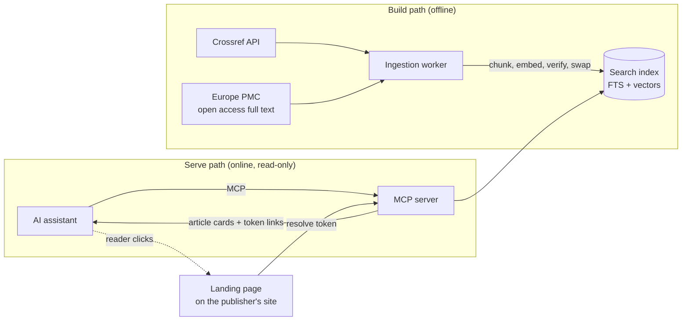

<div align="center">

# scholarly-mcp

**Turn AI assistants into a discovery channel for scholarly publishers.**

An MCP server that answers research questions with a short list of relevant articles,
each linking to a personalised landing page on the publisher's own site, never the article itself.

[](https://github.com/sami3ullah/scholarly_mcp/actions/workflows/ci.yml)
[](https://github.com/sami3ullah/scholarly_mcp/actions/workflows/security.yml)


[Quick start](#quick-start) · [Tools](#tools) · [Your own content](#your-own-content-api) · [Architecture](#architecture) · [Limitations](#limitations) · [Docs](#documentation)

</div>

> [!NOTE]
> Independent prototype, **not affiliated with Thieme** or any other publisher. It ships with a preset for
> Thieme's DOI prefix (`10.1055`) as a worked example and works with any Crossref prefix.

---

## Quick start

Requirements: Docker. The image carries a small demo index of open access (CC BY 4.0) articles, the embedding model and the Thieme preset, so it needs no other setup.

```bash
docker run -d --name scholarly-mcp -p 127.0.0.1:8080:8080 ghcr.io/sami3ullah/scholarly-mcp:latest
docker exec scholarly-mcp /nodejs/bin/node /app/scholarly-mcp.mjs keys create --label me   # prints smk_…
```

Connect Claude Code (or any MCP client that speaks Streamable HTTP) with the printed key:

```bash
claude mcp add --transport http scholarly http://localhost:8080/mcp --header "Authorization: Bearer smk_…"
```

Then ask, for example, _"Find recent articles on stroke thrombolysis"_ or _"Welche Artikel gibt es zur Sepsis bei Kindern?"_. Claude Desktop, MCP Inspector and stdio are in the [client guide](docs/guides/connecting-clients.md).

<details>
<summary><b>The full stack from a clone: server, landing page, Postgres</b></summary>

```bash
git clone https://github.com/sami3ullah/scholarly_mcp.git && cd scholarly_mcp
export SCHOLARLY_IMAGE=ghcr.io/sami3ullah/scholarly-mcp:latest LANDING_IMAGE=ghcr.io/sami3ullah/scholarly-mcp-landing:latest
docker compose --profile sqlite --profile landing up -d --wait     # MCP on :8080, landing page on :3000
docker compose run --rm server keys create --label me
```

Swap `sqlite` for `postgres` to run on Postgres. The demo index has about 200 articles; for the whole Thieme corpus build the full index with `ingest full` ([ingestion guide](docs/guides/ingestion.md), a few hours). Deploying for others: [operations](docs/OPERATIONS.md).

</details>

## Tools

Six read-only MCP tools. Every one returns article cards, never article content.

| Tool              | Purpose                                                             |
| ----------------- | ------------------------------------------------------------------- |
| `search_articles` | Hybrid search with language, journal, year and open access filters  |
| `get_article`     | One card for a known DOI                                            |
| `find_related`    | Nearest neighbours of an article                                    |
| `get_journal`     | Journal details and its page link                                   |
| `cite`            | Formatted citation (Vancouver, APA, AMA, BibTeX, RIS)               |
| `check_access`    | Open, subscription or institutional access, plus login or buy links |

<details>
<summary><b>What an article card looks like</b></summary>

```json
{
  "title": "Current Evidence on Local Therapies in Advanced Adrenocortical Carcinoma",
  "journal": "Hormone and Metabolic Research",
  "year": 2024,
  "firstAuthor": "Kimpel",
  "teaser": "At most 280 characters, cut at a word boundary…",
  "whyMatched": "matched in Results: local therapy",
  "access": "open",
  "license": "https://creativecommons.org/licenses/by/4.0/",
  "url": "https://…/mcp/landing?t=<token>&doi=10.1055/a-2209-6022&utm_source=mcp&utm_medium=ai&utm_campaign=search_articles",
  "doi": "10.1055/a-2209-6022"
}
```

Every response also carries `"notice": "Evidence pointers, not clinical advice. Independent prototype, not affiliated with Thieme."` and a plain-text version with linked titles.

</details>

All six tools work over stdio and Streamable HTTP, with API keys or OAuth, rate limits, usage metering, health checks, Prometheus metrics and traces ([operating guide](docs/guides/operating-the-server.md)).

## Your own content API

The demo indexes Crossref and Europe PMC. A publisher points it at its own catalogue by writing one `Source` adapter: a function that pages through the API and returns canonical articles. A shared contract suite checks it against recorded responses, and one line in the ingest's composition root wires it in. Access rules (`Entitlements`), the store (SQLite or Postgres), the embedding model and the billing export plug in the same way. The [adapters guide](docs/ADAPTERS.md) walks through each.

## Architecture

Clinicians and researchers increasingly ask AI assistants instead of visiting publisher sites. **scholarly-mcp** gives a publisher that reach while keeping readers, and the reading itself, on the publisher's site.



1. **Ask.** A reader asks their assistant a question, in German or English.
2. **Search.** The server runs lexical and semantic search in parallel and fuses them with Reciprocal Rank Fusion.
3. **Answer.** The assistant gets a few article cards: title, journal, year, a short teaser, why it matched, and a link.
4. **Click.** The link opens a landing page rebuilt from a short-lived token: no query text ever appears in the URL.

Ports and adapters: the core knows nothing about Crossref, SQLite or Postgres, so each can be swapped without
touching search or the tools.

```
scholarly-mcp/
├── packages/
│   ├── core/              domain types, zod schemas, ports, article cards
│   ├── search/            search service: query pipeline, RRF fusion, teasers, cursors
│   ├── cite/              citations: Vancouver, APA, AMA, BibTeX, RIS
│   ├── source-crossref/   Crossref adapter (metadata, abstracts, licenses)
│   ├── source-europepmc/  open access full text, used for matching only
│   ├── store-sqlite/      FTS5 + trigram + sqlite-vec, landing sessions
│   ├── store-postgres/    tsvector + pgvector, migrations
│   ├── embedder-onnx/     multilingual-e5-small via transformers.js
│   ├── logger/            pino logger with query and secret redaction
│   └── testkit/           contract suites, fixtures, golden set
├── apps/
│   ├── ingest/            CLI: full, incremental, verify, subset
│   ├── eval/              CLI: search latency bench and golden-set eval
│   ├── server/            MCP server: six tools, stdio and Streamable HTTP
│   └── landing/           Next.js reference landing page
├── docker/                images, compose services, demo index, smoke and load tests
└── docs/                  operations, adapters, landing, security, plan, ADRs, guides
```

| Layer            | Swappable via  | Default                           | Production                                                                          |
| ---------------- | -------------- | --------------------------------- | ----------------------------------------------------------------------------------- |
| Content source   | `Source`       | Crossref + Europe PMC             | Your content API ([adapters](docs/ADAPTERS.md#your-own-content-api))                |
| Search index     | `Store`        | SQLite (FTS5 + sqlite-vec)        | Postgres (tsvector + pgvector), `STORE=postgres` ([guide](docs/guides/postgres.md)) |
| Embeddings       | `Embedder`     | multilingual-e5-small, in-process | Any ONNX model ([ADR 0028](docs/adr/0028-selectable-embedding-model.md))            |
| Landing sessions | `SessionStore` | SQLite                            | Postgres                                                                            |
| Access status    | `Entitlements` | Mock                              | Your entitlement service                                                            |
| Usage events     | `Meter`        | Outbox + signed webhook           | Your billing pipeline                                                               |

Read more in the [engineering plan](docs/PLAN.md#high-level-architecture) and the [ADRs](docs/adr/README.md).

<details>
<summary><b>Develop</b></summary>

Requirements: **Node 24 LTS** (via [nvm](https://github.com/nvm-sh/nvm)), **pnpm 10** (via corepack), Docker for the images and Postgres tests.

```bash
git clone https://github.com/sami3ullah/scholarly_mcp.git && cd scholarly_mcp
nvm use && corepack enable
pnpm install
pnpm check        # format, lint, typecheck, layering rules, tests with coverage
```

| Script                                      | What it does                                                                        |
| ------------------------------------------- | ----------------------------------------------------------------------------------- |
| `pnpm check`                                | Everything CI runs, in order                                                        |
| `pnpm test`                                 | Unit, contract and fuzz tests (Vitest)                                              |
| `pnpm test:coverage`                        | Tests with the 85% coverage gate                                                    |
| `pnpm lint`                                 | ESLint, strict and type-aware                                                       |
| `pnpm typecheck`                            | `tsc` across all packages (Turborepo)                                               |
| `pnpm depcruise`                            | Enforces the layering rules between packages                                        |
| `pnpm format`                               | Prettier                                                                            |
| `pnpm ingest <full\|incremental\|verify>`   | Build, refresh or check the index ([guide](docs/guides/ingestion.md))               |
| `pnpm ingest <migrate\|copy --from <file>>` | Prepare Postgres, load an existing index into it ([guide](docs/guides/postgres.md)) |
| `pnpm eval bench`                           | Times every search end to end on the live index                                     |
| `docker/e2e/smoke.sh [sqlite\|postgres]`    | The compose stack on the demo index, every tool over HTTP                           |
| `docker/e2e/load.sh <index dir>`            | Load test: cold start, latency at 20 calls a second, memory                         |

</details>

## Guardrails

- **Official APIs only** (Crossref, Europe PMC). No scraping.
- **No article content in chat** beyond a 280-character teaser.
- **No query text** in URLs, logs or stores. A clinician may type patient details; we never keep them.
- **Retracted papers** are excluded by default and flagged when fetched directly.
- **Not clinical advice.** Every response carries a notice; the server never generates answers.
- **Open access full text is for matching only.** CC BY and CC BY-NC-ND text helps ranking but is never shown or exported ([ADR 0003](docs/adr/0003-cc-by-nc-nd-full-text-for-matching-only.md)).

## Limitations

| Limitation                                                                                                                                                                                                                                                                                                                                                                    | Impact                                                                                                                                                                                          | Fix                                                                                                                   |
| ----------------------------------------------------------------------------------------------------------------------------------------------------------------------------------------------------------------------------------------------------------------------------------------------------------------------------------------------------------------------------- | ----------------------------------------------------------------------------------------------------------------------------------------------------------------------------------------------- | --------------------------------------------------------------------------------------------------------------------- |
| **The public image has a demo index.** It carries about 200 CC BY 4.0 articles, two per journal, because the full index holds content that may not be redistributed ([ADR 0039](docs/adr/0039-demo-index-from-a-cc-by-doi-list.md)).                                                                                                                                          | Many questions find little or nothing.                                                                                                                                                          | Build the full index with `ingest full` and mount or bake it in ([operations](docs/OPERATIONS.md#deploy)).            |
| **Crossref public pool.** No contact email is configured, so ingestion uses Crossref's slower public pool instead of the polite pool ([ADR 0005](docs/adr/0005-crossref-public-pool.md)).                                                                                                                                                                                     | The first full ingestion is slower and sees more rate limiting. Incremental syncs are barely affected.                                                                                          | Set `CROSSREF_MAILTO`.                                                                                                |
| **Thin abstracts.** About half of recent Thieme articles have no abstract in Crossref.                                                                                                                                                                                                                                                                                        | Those articles match on title, journal and subjects, plus their full text when they are open access in Europe PMC (used for matching only, [ADR 0024](docs/adr/0024-europe-pmc-enrichment.md)). | A publisher's own content API removes it.                                                                             |
| **Coarse subjects for some articles.** Crossref has no subjects; Europe PMC covers only part of the corpus ([ADR 0004](docs/adr/0004-subjects-from-europe-pmc.md)).                                                                                                                                                                                                           | Articles outside Europe PMC get journal-level subjects.                                                                                                                                         | A publisher's own taxonomy via a source adapter.                                                                      |
| **Embargoes open on a full run.** An article whose open licence starts in the future is indexed as closed; incremental runs skip unchanged records, so it opens at the next full run, which `ingest incremental` triggers every 7 days by default ([ADR 0020](docs/adr/0020-crossref-source-ingestion-rules.md), [ADR 0022](docs/adr/0022-sqlite-index-files-and-builds.md)). | Until then it shows as paywalled, with the abstract and a subscribe link.                                                                                                                       |
| **No journal page links by default.** No verified ISSN-based journal URL is known for the publisher's site.                                                                                                                                                                                                                                                                   | `get_journal` and `get_article` omit the journal link.                                                                                                                                          | Set `JOURNAL_URL_TEMPLATE`.                                                                                           |
| **Search recall below target.** On the 60-query golden set, recall@10 is 0.68 overall and 0.56 cross-language, against targets of 0.8 and 0.7 ([ADR 0026](docs/adr/0026-golden-set-eval-and-tuning.md)). Larger embedding models did not close the gap ([ADR 0029](docs/adr/0029-keep-e5-small-after-model-comparison.md)).                                                   | Some relevant articles, most often for German and cross-language queries, are not on the first page.                                                                                            | Next levers are query translation and a reranker ([ADR 0029](docs/adr/0029-keep-e5-small-after-model-comparison.md)). |

## Roadmap

| Ticket                                             | Scope                                                | Status |
| -------------------------------------------------- | ---------------------------------------------------- | :----: |
| [SM-00](tickets/SM-00-feasibility-spike.md)        | Feasibility spike ([results](docs/spike-results.md)) |   ✅   |
| [SM-01](tickets/SM-01-foundations.md)              | Monorepo foundations and CI                          |   ✅   |
| [SM-02](tickets/SM-02-core-domain.md)              | Core domain, ports, config, errors, testkit          |   ✅   |
| [SM-03](tickets/SM-03-crossref-source.md)          | Crossref source and normalisation                    |   ✅   |
| [SM-04](tickets/SM-04-chunker-embedder.md)         | Chunker and ONNX embedder                            |   ✅   |
| [SM-05](tickets/SM-05-sqlite-store-ingest.md)      | SQLite store and ingest CLI                          |   ✅   |
| [SM-06](tickets/SM-06-europepmc-source.md)         | Europe PMC full-text source                          |   ✅   |
| [SM-07](tickets/SM-07-search-service.md)           | Search service                                       |   ✅   |
| [SM-08](tickets/SM-08-golden-set-eval.md)          | Golden set, eval and tuning                          |   ✅   |
| [SM-09](tickets/SM-09-mcp-server.md)               | MCP server: six tools and transports                 |   ✅   |
| [SM-10](tickets/SM-10-auth-telemetry-metering.md)  | Auth, rate limits, telemetry, metering               |   ✅   |
| [SM-11](tickets/SM-11-landing.md)                  | Landing sessions and Next.js landing page            |   ✅   |
| [SM-12](tickets/SM-12-mcp-apps-funnel.md)          | MCP Apps cards and funnel dashboard                  |   ✅   |
| [SM-13](tickets/SM-13-postgres-adapter.md)         | Postgres adapter                                     |   ✅   |
| [SM-14](tickets/SM-14-hardening-docs.md)           | Hardening, image and docs                            |   ✅   |
| [SM-15](tickets/SM-15-demo-outreach.md)            | Demo deployment                                      |   ⬜   |
| [SM-16](tickets/SM-16-embedding-model-eval.md)     | Embedding model evaluation (bge-m3)                  |   ✅   |
| [SM-17](tickets/SM-17-sqlite-search-throughput.md) | SQLite search throughput                             |   ⬜   |

Full board: [tickets/README.md](tickets/README.md).

## Documentation

Everything lives in [`docs/`](docs/README.md):

| Document                                     | For                                                         |
| -------------------------------------------- | ----------------------------------------------------------- |
| [Docs index](docs/README.md)                 | Start here: every guide in one place                        |
| [Engineering plan](docs/PLAN.md)             | The full design: goals, architecture, edge cases, standards |
| [Architecture decisions](docs/adr/README.md) | Why things are the way they are                             |
| [Phase 0 results](docs/spike-results.md)     | Data coverage and model checks                              |
| [Operations](docs/OPERATIONS.md)             | Deploying, refreshing, scaling, capacity, monitoring        |
| [Adapters](docs/ADAPTERS.md)                 | Plugging in your own content API, access rules or store     |
| [The landing page](docs/LANDING.md)          | The landing API and building the page in your own stack     |
| [Security](docs/SECURITY.md)                 | Reporting issues, threat model, controls, supply chain      |

## Contributing

- Conventional Commits, checked on every commit. Small, focused PRs (under ~400 lines).
- `pnpm check` must pass. The [PR template](.github/pull_request_template.md) asks which edge cases you covered.
- A change to a key design decision needs an [ADR](docs/adr/).

---

<div align="center">
<sub>Evidence pointers, not clinical advice. Independent prototype, not affiliated with Thieme.</sub>
</div>
