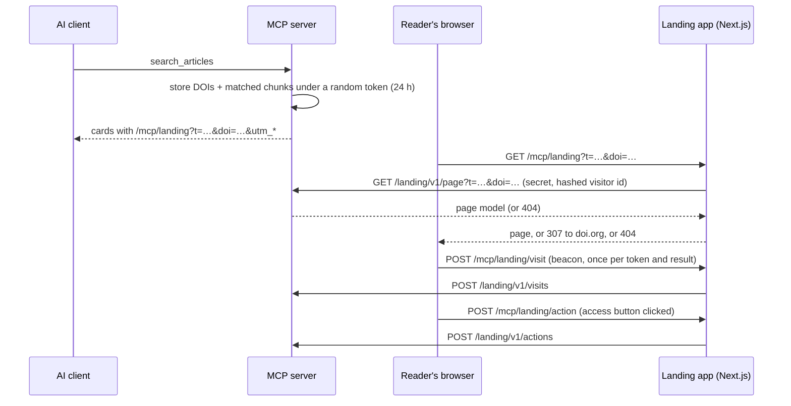

# The landing page

[← Back to the docs index](README.md)

Every article link the MCP server returns opens a landing page built for that search. The reference page shows that one article as a focused reading page: how to read it, where the search matched, the abstract, and related reading at the end. The landing API also returns the search's other results and topic labels, which the reference page leaves out ([ADR 0046](adr/0046-focused-reference-landing-page.md)) and a publisher's own page may show. This guide covers running the reference page, the landing API behind it, and what to keep if you rebuild the page in your own stack. Design decisions are in [ADR 0032](adr/0032-landing-api-and-reference-landing-page.md).

## How a click becomes a page



No query text goes into any of these requests. The token holds only the result DOIs and matched chunk ids.

## Run it locally

```bash
source ~/.nvm/nvm.sh && nvm use
pnpm build:packages
pnpm --filter @scholarly-mcp/landing build

# Terminal 1: the server over HTTP, with links pointing at the landing app
LANDING_BASE_URL=http://localhost:3100 MCP_TRANSPORT=http EMBEDDER_CACHE_DIR=.cache/models \
  node --env-file=presets/thieme.env apps/server/dist/main.js

# Terminal 2: the landing app, calling the server's landing API
cd apps/landing && LANDING_API_URL=http://127.0.0.1:8080 npx next start --port 3100
```

Run a search from any MCP client and open one of the card links.

With Claude Desktop on stdio, add `HTTP_ALONGSIDE_STDIO=true` to the server's environment. The server then also listens on `HTTP_PORT` for the landing API, without `/mcp`. If a second client already holds the port, stdio keeps working and the server logs that landing links will fail.

## Configuration

Server (see also [Operating the server](guides/operating-the-server.md)):

| Variable                        | Default     | Meaning                                                                         |
| ------------------------------- | ----------- | ------------------------------------------------------------------------------- |
| `LANDING_BASE_URL`              | -           | Where links point, e.g. `https://landing.example.org` (a base path is kept)     |
| `LANDING_API_SECRET`            | -           | Bearer token the landing API requires; 32+ characters; required beyond loopback |
| `LANDING_RATE_LIMIT_PER_MINUTE` | `120`       | Landing API requests per visitor per minute                                     |
| `LANDING_RATE_LIMIT_BURST`      | `30`        | Burst size of that bucket                                                       |
| `HTTP_ALONGSIDE_STDIO`          | `false`     | Also serve health, metrics and the landing API while MCP runs on stdio          |
| `LANDING_API_PORT`              | -           | Serve the landing API on its own port instead; the public port then 404s it     |
| `LANDING_API_HOST`              | `127.0.0.1` | Address of that listener                                                        |

Landing app:

| Variable                 | Default                 | Meaning                                      |
| ------------------------ | ----------------------- | -------------------------------------------- |
| `LANDING_API_URL`        | `http://127.0.0.1:8080` | The server's HTTP address                    |
| `LANDING_API_SECRET`     | -                       | The same secret as the server's              |
| `LANDING_API_TIMEOUT_MS` | `3000`                  | How long a page waits for the API            |
| `LOG_LEVEL`              | `info`                  | Log level of the app's server-side JSON logs |

The app's rate limit keys on the first `x-forwarded-for` hop, else `x-real-ip`, so run it behind a proxy that sets one of them from the reader's address and drops any value the reader sent. Only a salted hash of the address reaches the server.

Both sides take the secret from a mounted file as well: `LANDING_API_SECRET_FILE=/run/secrets/landing_api_secret` instead of `LANDING_API_SECRET` (not both).

## Run it in containers

The compose `landing` profile runs the app's image behind a Caddy proxy that sets `x-forwarded-for`, next to either server profile ([ADR 0038](adr/0038-landing-image-proxy-and-secret-files.md)):

```bash
docker compose --profile sqlite --profile landing up -d --wait
open http://localhost:3000/mcp/landing   # card links point here (LANDING_BASE_URL)
```

The server serves the landing API on port 8081 of an internal network that only the app joins, and the secret comes from the compose secret at `LANDING_API_SECRET_PATH`. To build the app image alone: `docker build -f docker/landing/Dockerfile -t scholarly-mcp-landing .`. A standalone build outside Docker is `LANDING_STANDALONE=true pnpm --filter @scholarly-mcp/landing build`; `next start` does not run that output, `node apps/landing/.next/standalone/apps/landing/server.js` does.

## The landing API

Both routes check the `Host` allowlist (`HTTP_ALLOWED_HOSTS`), the bearer secret and the per-visitor bucket. They answer `cache-control: no-store` and `x-robots-tag: noindex`.

### `GET /landing/v1/page?t=<token>&doi=<doi>`

Both parameters are optional. A malformed token counts as unknown, so the page still falls back to the DOI.

| Answer | When                                                                       |
| ------ | -------------------------------------------------------------------------- |
| 200    | A page: `landingPageSchema` in `packages/core/src/landing/landing-page.ts` |
| 400    | `doi` is not a DOI                                                         |
| 401    | Missing or wrong secret                                                    |
| 403    | `Host` not allowed                                                         |
| 404    | No live session and no indexed DOI: nothing to show                        |
| 429    | The visitor's bucket is empty; `retry-after` says when to retry            |

The page's `session` field is `active` (results rebuilt), `unavailable` (expired or unknown token, so only the article is shown) or `none` (a link without a token).

```jsonc
{
  "session": "active",
  "language": "de", // the search's language, else the article's
  "topics": ["Atrial Fibrillation", "Treatment Outcome"], // from shared subjects, never the query
  "chosen": {
    "doi": "10.1055/a-2646-5752",
    "title": "…",
    "journal": "…",
    "year": 2025,
    "authors": ["…"],
    "authorCount": 4,
    "published": { "year": 2025, "month": 9 },
    "abstract": "…",
    "subjects": ["…"],
    "teaser": "…",
    "access": "subscription",
    "license": "unknown",
    "retracted": false,
    "articleUrl": "https://…",
    "doiUrl": "https://doi.org/10.1055/a-2646-5752",
  },
  "access": { "status": "subscription", "loginUrl": "https://…", "purchaseUrl": "https://…" },
  "matchedPassage": { "in": "abstract", "section": "Results", "text": "…" }, // or { "in": "title" } or { "in": "fullText", "section": "Methods" }
  "matches": [
    /* the other results, in order: doi, title, journal, year, firstAuthor, teaser, access, retracted */
  ],
  "related": [/* up to 3 nearest articles that were not results */],
}
```

### `POST /landing/v1/visits`

The body is `{ "t": "<token>", "doi": "<opened result>", "tool": "search_articles" }`, and `tool` is optional. The answer is 204, whether or not anything was recorded. A visit is recorded only when the token is live and the DOI is one of its results. It then increments the session's `visitCount` and `landing_visits_total{tool}`, and it writes a `landing_visit` event for the funnel ([ADR 0033](adr/0033-referral-events-funnel-and-card-view.md)). The tool comes from the session when it knows it, else from `tool`. Any other field is refused with 400, so query text cannot be sent.

### `POST /landing/v1/actions`

The body is `{ "t": "<token>", "doi": "<result>", "action": "read" }`. The action is one of `read`, `sign_in`, `buy`, `view_on_publisher` or `check_access`. The same checks and the same 204 answer apply as for visits. A recorded click increments `landing_actions_total{action}` and writes a `landing_action` event. See [The funnel and the card view](guides/funnel-and-card-view.md).

## Rebuilding the page in your own stack

Keep these rules. They come from the hard rules in PLAN.md and are each covered by a test in this repo:

1. **Fetch on the server.** Call the API from your backend with the secret, never from the browser.
2. **Never index.** Send `noindex` in the meta tag and the header, with the article page as canonical.
3. **Fall back, never error.** No page and a DOI means a redirect to the article (doi.org or your own article page). No page and no DOI means a 404 page. API failures with a DOI also redirect.
4. **Count visits in the browser.** Send one beacon per token, result and tab after the page is shown, and wait while the page is prerendered. Skip moves between results on your own page. Drop preview agents, prefetches and cross-site posts. Never count on GET.
5. **Count access button clicks.** Send one action beacon per token, result, action and tab with `sendBeacon`, so it survives the navigation.
6. **Show no full text.** A `fullText` match shows its section label only.
7. **Never show the query.** Use `topics`.
8. **Lead with the chosen article.** On a phone, the access options sit in the first screen.

## Testing

```bash
pnpm test                                         # unit tests, landing included (Vitest, Testing Library)
pnpm --filter @scholarly-mcp/landing build        # the e2e suite runs the built app
pnpm --filter @scholarly-mcp/landing e2e          # Playwright + axe, desktop and mobile (stub API)
pnpm --filter @scholarly-mcp/landing lhci         # Lighthouse budgets: LCP < 2.5 s, a11y 1.0
```

The first Playwright run needs a browser: `pnpm --filter @scholarly-mcp/landing exec playwright install chromium`. The e2e suite and Lighthouse start their own stub API (`apps/landing/e2e/stub-api.mjs`, synthetic articles) on port 8299, and the app on port 3200. GitHub CI runs both in the `landing` job.
