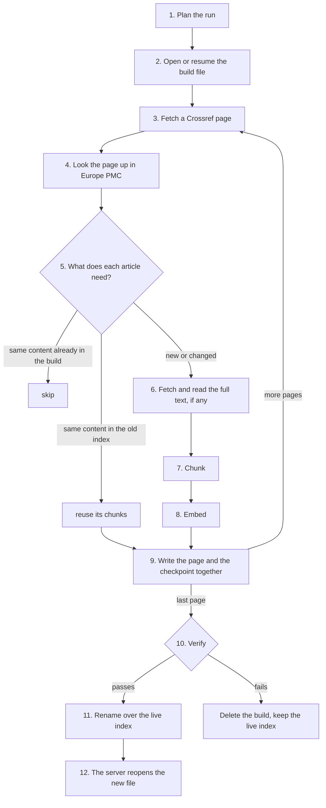

# How ingestion works, and how it was built

[← Back to the docs index](../README.md)

This guide explains, step by step, how scholarly-mcp turns publisher metadata into a search index, and how each part was designed and built. It is written for someone new to the project. To run ingestion, see the [ingestion guide](ingestion.md); for the reasoning behind each rule, follow the ADR links.

## In one paragraph

Ingestion reads every Thieme journal article since 2024 from **Crossref** (titles, abstracts, licences), adds **subjects** and, for open access articles, **full text** from **Europe PMC**. It cuts each article into short passages (**chunks**) and turns each chunk into a list of 384 numbers (an **embedding**) that captures its meaning. Everything is written into a new SQLite file next to the live index. When the new file passes its checks, it replaces the live one in a single step. The search server only ever reads that file. Full text helps an article be _found_ but is never _shown_: readers see a short teaser from the abstract and a link to the publisher.

## Words used here

| Term                    | Meaning                                                                                                                                             |
| ----------------------- | --------------------------------------------------------------------------------------------------------------------------------------------------- |
| DOI                     | The permanent id of an article, e.g. `10.1055/a-2272-9794`. Stored lowercase.                                                                       |
| Crossref                | The registry publishers deposit article metadata with. Our main source.                                                                             |
| Europe PMC              | A free archive of life-science literature. Gives us MeSH subjects and open access full text.                                                        |
| PMCID                   | Europe PMC's id for a full text, e.g. `PMC11288659`.                                                                                                |
| JATS                    | The XML format journals use for articles. Crossref abstracts and Europe PMC full texts are JATS.                                                    |
| MeSH                    | Medical Subject Headings, the U.S. National Library of Medicine's subject vocabulary.                                                               |
| Version of record (VoR) | The final published version. Its licence decides what we may do with the text.                                                                      |
| Author manuscript       | The accepted draft before publisher editing. Not the version of record, so we do not use its text.                                                  |
| Chunk                   | A passage of up to 400 model tokens. The unit search retrieves.                                                                                     |
| Embedding               | 384 numbers per chunk from the `multilingual-e5-small` model; similar meanings give nearby vectors, across German and English.                      |
| Content hash            | A SHA-256 fingerprint of an article's content. Same hash means nothing changed, so work can be skipped.                                             |
| Origin                  | Where a chunk's text came from: `metadata` (title), `abstract` or `fulltext`. Only the first two may ever be shown.                                 |
| Port / adapter          | A port is an interface in `packages/core` (e.g. `Source`); an adapter implements it for one system (e.g. Crossref). Core never knows which adapter. |

## The whole flow

The command decides only step 1. Everything else is the same for `ingest full` and `ingest incremental`.

## Step by step

### 1. Plan the run

Code: `apps/ingest/src/plan-run.ts`

A scheduler only ever runs `ingest incremental`. The planner turns that into a **full** run when there is no index yet, when the index file has an older layout, or when the last full run is more than `INGEST_FULL_RUN_DAYS` (7) old.

Why full runs are needed at all: an incremental run asks Crossref only for records changed since the last run. A full run fetches everything again, which is the only way to notice:

- an embargo that has ended (the licence starts in the future, so the article counts as closed until a run sees it again)
- an article removed upstream
- a full text Europe PMC received months after publication

### 2. Open or resume the build file

Code: `packages/store-sqlite/src/build/index-build.ts`

The new index is written to `data/index.sqlite.building`; the live `data/index.sqlite` is never written.

- A **full** run starts from an empty file.
- An **incremental** run starts from a copy of the live index (`VACUUM INTO`), so the server can keep reading the original.
- If a build of the same kind was interrupted (a crash, Ctrl-C, an outage), it is **resumed**. The checkpoint (where in Crossref's list to continue) is stored inside the build file itself, written in the same transaction as the articles before it, so the two can never disagree.

### 3. Fetch a Crossref page

Code: `packages/source-crossref` ([ADR 0020](../adr/0020-crossref-source-ingestion-rules.md))

- Walks `/prefixes/10.1055/works`, journal articles only, sorted by deposit date, 1,000 records per page, using Crossref's cursor. If Crossref forgets the cursor, the walk restarts from the latest deposit date already seen.
- Requests go one at a time, at Crossref's advertised rate. Failures are retried with growing, randomised waits that honour `Retry-After`. This retry logic is shared with Europe PMC in `packages/http`.
- **Notices are skipped:** errata, corrections and retraction notices are not articles a reader should find.
- **Retractions are flagged:** when a page holds a retraction notice, the retracted article is looked up and marked, so search hides it.
- **Cleaning:** JATS abstracts become plain text with section labels ("Results: …"). Abstracts that are only a citation of another article are dropped. Text is Unicode-normalised so German compounds match.
- **Licence gate:** an article is open access only if its version-of-record licence is Creative Commons and already in force.
- Each article gets a content hash.

### 4. Look the page up in Europe PMC

Code: `packages/source-europepmc` ([ADR 0024](../adr/0024-europe-pmc-enrichment.md)), on when `EUROPEPMC_ENABLED=true`

One search request covers 100 DOIs (`DOI:"a" OR DOI:"b" …`), so a page of 1,000 articles costs 10 requests. A hit counts only if it states the requested DOI itself; preprints are ignored.

Each match gives:

- **Subjects:** MeSH descriptor names (without tags such as "Humans", "Male", "Aged" that are on nearly every record) and up to 20 author keywords. Each is tagged with its origin (`mesh`, `keyword`).
- **A full-text reference**, only when every one of these holds:
  - Crossref's version-of-record licence is in force and on `FULLTEXT_LICENSE_ALLOWLIST` (CC BY 4.0 and CC BY-NC-ND 4.0 by default, [ADR 0003](../adr/0003-cc-by-nc-nd-full-text-for-matching-only.md))
  - the article is not retracted
  - Europe PMC holds it open access, with full text under its PMCID
  - Europe PMC's copy is not an author manuscript
  - Europe PMC's licence family matches Crossref's (e.g. both `by-nc-nd`)

The reference is `{ PMCID, licence URL, revision date }`, never the text. The subjects and the reference are added to the article and its **content hash is recomputed**. That one detail is what makes step 5 work.

### 5. Decide what each article needs

Code: `apps/ingest/src/prepare-record.ts`

Embedding is the slow part, and fetching a full text takes 1-2.5 s, so each article goes through these checks in order and stops at the first that applies:

| Check                                                          | Result                                                                    |
| -------------------------------------------------------------- | ------------------------------------------------------------------------- |
| The build already holds this exact hash                        | **unchanged**, nothing written (this is why a repeated run writes 0 rows) |
| The old live index holds this hash, embedded by the same model | **reused**: copy its chunks, fetch nothing (full rebuilds are cheap)      |
| The article references a full text                             | fetch it (step 6), then chunk and embed                                   |
| Otherwise                                                      | chunk and embed the metadata and abstract                                 |

If the full text turns out to be unusable, the reference is dropped, the hash is recomputed and the first two checks run again. Without that, an article whose text never arrives would be re-embedded on every run.

Because the hash covers the subjects and the full-text reference, a new MeSH heading or a revised full text changes the hash and the article is re-indexed. When nothing changed, nothing is done.

### 6. Fetch and read the full text

Code: `packages/source-europepmc/src/fulltext/read-full-text.ts`

`GET /{PMCID}/fullTextXML` returns JATS XML. Before using it, the reader checks that:

- the DOI inside the XML is the article's
- it is not flagged as a manuscript, preprint or retracted
- there is no text and data mining reservation
- any Creative Commons licence it states is the expected one

What is read, and what is not:

- Only `<body>`: not the front matter (the abstract already comes from Crossref) and not the back matter.
- Each top-level section becomes one section; subsections fold into it. Prose before the first section (common in case reports) becomes its own section.
- Dropped: figures, tables, formulas, captions, citation markers like "[12]", and back-matter sections inside the body (references, footnotes, funding, conflicts of interest, author contributions, ethics, data availability, errata), recognised in English and German.
- **Headings are never kept.** A heading is article text. It is mapped to one of six generic labels (Introduction, Methods, Results, Discussion, Conclusion, Case report), and anything else gets no label. "Hintergrund" becomes Introduction; "Stärken und Limitationen" gets none.

A missing text (404), a rejected one or one that keeps failing is skipped with a logged reason, and the article falls back to its metadata. Five failures in a row stop the run, because Europe PMC is probably down; the next run resumes.

### 7. Chunk

Code: `packages/core/src/chunk/` ([ADR 0021](../adr/0021-chunking-language-and-embedder-rules.md))

- **Structure first.** Each abstract section and each full-text section is a hard boundary. So is a change of language between paragraphs, because some German articles have English abstracts.
- **Sizes.** Chunks are at most 400 tokens, counted with the model's own tokenizer, and balanced (450 tokens become about 225 + 225, not 400 + 50). Sentences are the fallback unit; a chunk repeats up to two sentences from the one before it.
- **Language per chunk.** It is detected per paragraph from German and English function words.
- **Title in front.** The article title is prepended to each chunk's embedding text, so a short passage keeps its context.
- **No abstract.** The article gets one `metadata` chunk of its title, so it can still be found.
- **Full text.** Full-text chunks get origin `fulltext`, source `europepmc` and the licence URL. Ingestion sets these from the reference, not the adapter, so no adapter can mislabel a chunk as displayable.

### 8. Embed

Code: `packages/embedder-onnx`

The model (by default `Xenova/multilingual-e5-small`, pinned revision, 8-bit weights; `EMBEDDER_MODEL` picks another, ADR 0028) runs in-process. Each chunk is embedded with the prefix `passage: `; queries later get `query: `, as e5 models expect. One text at a time, so the same text always gives the same vector. The model version is stored with every chunk; an index never mixes models.

### 9. Write the page and the checkpoint

Code: `packages/store-sqlite/src/articles/write-records.ts` ([ADR 0022](../adr/0022-sqlite-index-files-and-builds.md))

One transaction per page writes:

| Table            | What it holds                                                                                              |
| ---------------- | ---------------------------------------------------------------------------------------------------------- |
| `articles`       | The canonical record (JSON), content hash and the columns search filters on                                |
| `chunks`         | Chunk text, section, language, origin, source, licence URL, model version                                  |
| `chunks_fts`     | Full-text search on stemmed text (German and English Snowball, after folding "ä" to "ae") and on the title |
| `chunks_trigram` | Substring matching for German compounds ("Vorhofflimmertherapie" from "Vorhofflimmern")                    |
| `vec_chunks`     | The vector plus the filter columns, so vector search reads one narrow table                                |
| `sync_state`     | The checkpoint: Crossref cursor, window, run status                                                        |

### 10. Verify

Code: `packages/store-sqlite/src/build/verify-index.ts`

Before anything replaces the live index:

- SQLite and full-text-search integrity checks pass.
- There is at least one article, every article has a chunk, every chunk has a vector, and all vectors come from the expected model.
- The new index has **no more than 10% fewer** articles than the live one. A broken source or filter must not wipe the index.
- **Sample queries** work: sampled articles are found by their title words and sampled chunks by their own vector, both in the top 10.

A build that fails is deleted and the live index stays as it was.

### 11. Swap

The build is vacuumed into one self-contained file and **renamed** over `data/index.sqlite`. A rename is atomic: a reader sees either the old file or the new one, never half of each.

### 12. The server follows

The server (SM-09) opens the index read-only and checks its version now and then (`refresh()`); on a new version it reopens. Landing sessions and usage counts live in a separate runtime file, so they survive every swap.

## How full text stays hidden

Matching-only use is enforced in four layers, each with tests:

1. **Types.** A full-text section can carry only one of six generic labels (`fullTextSectionSchema` in core). A full-text chunk must have a licence, or it fails validation.
2. **Ingestion stamps provenance.** Origin, source and licence come from the article's reference, not from the adapter.
3. **Search shows labels and query words only.** The teaser comes from the abstract; `whyMatched` reads "Matched in Methods (full text): thrombectomy" and quotes nothing. A property test feeds random full-text words and checks that no word except the query's own terms ever reaches a result or a log line (`packages/search/src/service/full-text-guardrail.test.ts`).
4. **Later tickets** extend the same test to every MCP tool's output (SM-09) and the landing page passage (SM-11).

To remove all full text under one licence, take it off `FULLTEXT_LICENSE_ALLOWLIST` and run `ingest purge-license <url>`. It goes through the same copy, verify and swap steps.

## When things go wrong

| What happens                       | What the system does                                                                   |
| ---------------------------------- | -------------------------------------------------------------------------------------- |
| Crossref or Europe PMC returns 429 | Waits as long as `Retry-After` says (up to 60 s), else fails the run as `RATE_LIMITED` |
| 5xx, timeout, network error        | Retries with exponential backoff and jitter, then fails the page                       |
| The process is killed mid-run      | The build file keeps every finished page and its checkpoint; the next run resumes      |
| Crossref forgets the cursor        | Restarts from the latest deposit date seen; duplicates are harmless (upserts)          |
| A malformed record                 | Skipped and counted; the rest of the page goes on                                      |
| A full text is missing or unusable | The article is indexed from metadata, with a logged reason                             |
| The new index looks wrong          | Verification fails, the build is deleted, the live index stays                         |

## How it was built

### The approach

The same pattern was used for every ticket:

1. **Read the plan and the ADRs first.** `docs/PLAN.md` sets the goals and hard rules. ADRs record every decision the plan left open.
2. **Probe the real API before designing.** Every adapter started with live requests against real Thieme records, and the findings shaped the rules. The ADRs list them as "facts found while building it".
3. **Ports before adapters.** Core defines the interface and a contract test suite; the testkit has an in-memory fake that passes the suite; the real adapter must pass the same suite. Swapping Crossref for another source, or SQLite for Postgres, means writing one adapter.
4. **Recorded fixtures, no network in tests.** Real responses are saved under each adapter's `fixtures/` and replayed with msw. A script re-records them.
5. **Small commits that each pass `pnpm check`**: formatting, lint, type check, dependency rules (core may not import adapters, adapters may not import each other) and tests with an 85% coverage gate.
6. **An exit check on the real corpus.** A ticket is done only when its live check passes.

### Order of work

| Ticket | What it added                                                                                    |
| ------ | ------------------------------------------------------------------------------------------------ |
| SM-00  | Spike: coverage of abstracts, licences and Europe PMC; the model works across German and English |
| SM-01  | Monorepo, strict TypeScript, lint, tests, layering rules, CI                                     |
| SM-02  | Core types (article, chunk), ports, config, errors, testkit fakes and contract suites            |
| SM-03  | Crossref source: paging, retries, notices, retractions, JATS cleaning                            |
| SM-04  | Chunker and ONNX embedder                                                                        |
| SM-05  | SQLite store and the ingest CLI: build, resume, verify, swap                                     |
| SM-07  | Search service on top of the index                                                               |
| SM-06  | Europe PMC enrichment (this guide's steps 4 and 6), purge by licence                             |

### Worked example: SM-06, Europe PMC

1. **Probe.** One `OR` query for 100 DOIs returned everything in about 1.7 s. Of 200 random open access articles, 115 were in Europe PMC and 110 had usable full text. Surprises came from live responses:
   - a missing text answers HTTP 500, not 404
   - a JSON-only `accept` header is refused (406)
   - the licence URL often appears only in free text
   - one record matched a DOI query yet had no DOI
   - one closed article was held as an author manuscript

   Each became a rule and a test.

2. **Fit it to the ports.** Europe PMC does not list articles, it adds to them, so it got its own port (`ArticleEnricher`) rather than pretending to be a `Source`.
3. **Share the HTTP client.** Crossref's retry code moved into `packages/http` instead of being copied. All Crossref tests passed unchanged after the move.
4. **Make the rule structural.** Rather than trusting every caller to hide full text, the types allow only generic labels, and ingestion stamps the licence.
5. **Test on real documents.** The reader was run on English, German and case-report full texts, and gaps were fixed: German back matter, an erratum section, "Tables 1s–6s" headings, a false match on "Correctional facilities". Only CC BY texts are committed as fixtures; BY-NC-ND cases use small synthetic XML, so no ND text is redistributed.
6. **Keep reruns cheap.** The hash covers the full-text reference, so rebuilds reuse unchanged articles without fetching their text again.
7. **Exit check.** A full Thieme rebuild with enrichment, then a second run that must write 0 rows, then `ingest verify`. Results are recorded in the SM-06 ticket.

## Where the code lives

| Path                        | Role                                                                  |
| --------------------------- | --------------------------------------------------------------------- |
| `packages/core`             | Types, ports, chunker, licence gate, hashing; no I/O                  |
| `packages/http`             | Shared retrying HTTP client                                           |
| `packages/source-crossref`  | Crossref adapter (`Source`)                                           |
| `packages/source-europepmc` | Europe PMC adapter (`ArticleEnricher`)                                |
| `packages/embedder-onnx`    | The embedding model (`Embedder`)                                      |
| `packages/store-sqlite`     | Index file, search queries, builds, verification                      |
| `packages/search`           | The search service the MCP tools call                                 |
| `packages/testkit`          | Builders, in-memory fakes, contract suites for tests                  |
| `apps/ingest`               | The CLI that wires it all together (`main.ts`) and runs steps 1 to 11 |

## Further reading

- [Ingestion guide](ingestion.md): commands, scheduling, logs, troubleshooting
- [ADR index](../adr/README.md): every design decision
- [Engineering plan](../PLAN.md): goals, architecture and hard rules
