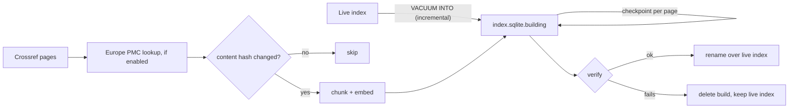

# Ingestion guide

[← Back to the docs index](../README.md)

How to build the search index from Crossref (and Europe PMC), keep it fresh and check it. For what each step does and why, read [how ingestion works](how-ingestion-works.md). Design rules: [ADR 0020](../adr/0020-crossref-source-ingestion-rules.md) (Crossref), [ADR 0024](../adr/0024-europe-pmc-enrichment.md) (Europe PMC), [ADR 0021](../adr/0021-chunking-language-and-embedder-rules.md) (chunking and embeddings), [ADR 0022](../adr/0022-sqlite-index-files-and-builds.md) (index files and builds).

## First build

```bash
nvm use
cp presets/thieme.env .env      # or set CROSSREF_PREFIX and CROSSREF_FROM_PUB_DATE yourself
pnpm ingest full
```

The first run downloads the embedding model (about 135 MB) unless `EMBEDDER_CACHE_DIR` points at a copy, and builds `data/index.sqlite`. `CROSSREF_ROWS=1000` cuts the number of requests tenfold for a first build.

## Keeping it fresh

Schedule one command, for example hourly or daily:

```bash
pnpm ingest incremental
```

It fetches records Crossref updated since the last run, with a 1-day overlap to absorb clock skew, and skips records whose content did not change. Every `INGEST_FULL_RUN_DAYS` (default 7) it runs a full rebuild instead: only a full run re-fetches unchanged records, which is what opens embargoed licences and drops records that left the corpus. Full rebuilds reuse the embeddings of unchanged articles, so they cost Crossref requests but little CPU.

## Europe PMC subjects and full text

With `EUROPEPMC_ENABLED=true` (set in the Thieme preset) every page is also looked up in Europe PMC by DOI, one request per 100 DOIs. Matched articles get MeSH and keyword subjects. Open access articles under an allowlisted licence also get their full text indexed, for matching only: it is never shown in results, teasers or `whyMatched`. The rules are in [ADR 0024](../adr/0024-europe-pmc-enrichment.md).

- **Turning it on:** run `pnpm ingest full` once. An incremental run only sees records Crossref changed, so most articles would wait for the next scheduled full run.
- **First build time:** Europe PMC serves one full text in 1 to 2.5 s, and texts are fetched one at a time, so the first build with enrichment takes a few hours. Later full runs fetch only new or revised texts and reuse the rest.
- **Missing or unusable text:** the article is indexed from its metadata and the reason is logged (`Full text not used`, `Full text missing, skipped`). Five failures in a row stop the run with `SOURCE_UNAVAILABLE`; the next run resumes it.

### Removing full text under a licence

If a rights holder asks, take the licence off `FULLTEXT_LICENSE_ALLOWLIST` first, then:

```bash
pnpm ingest purge-license https://creativecommons.org/licenses/by-nc-nd/4.0/
```

It copies the live index, deletes every full-text chunk under that licence, verifies and swaps the copy in. The command refuses a licence that is still on the allowlist, because the next run would index the text again.

## What a run does



- Each page is written in one transaction, then the checkpoint is saved in the same file.
- On a crash, Ctrl-C or a Crossref outage the build file stays; the next run of the same kind resumes from the checkpoint.
- The live index is replaced only by an atomic rename after verification. A server reading it picks up the new version on its next `refresh()`.

## Checking the index

```bash
pnpm ingest verify
```

Prints a JSON report and exits `1` when any check fails: SQLite and FTS integrity, at least one article, a chunk for every article and a vector for every chunk, one embedding model version, and sample queries that must find articles by their title and chunks by their own vector.

## Reading the logs

Runs log JSON lines (pino). The useful ones:

| Message                                                  | Fields                                                                                                     |
| -------------------------------------------------------- | ---------------------------------------------------------------------------------------------------------- |
| `Ingest planned`                                         | `kind` and `reason` (e.g. `last full run is over 7 days old`)                                              |
| `Ingest page written`                                    | running totals: `fetched`, `unchanged`, `reused`, `embedded`, `written`, `withFullText`, `fullTextSkipped` |
| `Europe PMC lookup done`                                 | per page: `requested`, `matched`, `withFullText`, `invalid`                                                |
| `Full text not used`                                     | a full text was another version or licence; `reason` says which                                            |
| `Index swapped in`                                       | the run report and the verify report                                                                       |
| `Index failed verification; the live index is unchanged` | which checks failed                                                                                        |

## Troubleshooting

| Symptom                                              | Cause and fix                                                                                 |
| ---------------------------------------------------- | --------------------------------------------------------------------------------------------- |
| `No index to update yet`                             | Not expected from the CLI (it plans a full run); seen when calling the store directly         |
| `The index has an older layout`                      | The schema or text processing changed; run `pnpm ingest full`                                 |
| `no unexpected shrink` fails                         | The new index has over 10% fewer articles than the live one; check the source config and logs |
| Segmentation fault on start                          | Not on Node 24; run `nvm use`                                                                 |
| `Europe PMC full text failed 5 times in a row`       | Europe PMC is down or slow; rerun later, the build resumes from its checkpoint                |
| `Remove the licence from FULLTEXT_LICENSE_ALLOWLIST` | `purge-license` was given a licence still on the allowlist; remove it first                   |
