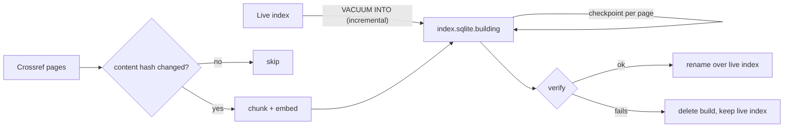

# Ingestion guide

[← Back to the docs index](../README.md)

How to build the search index from Crossref, keep it fresh and check it. Design rules: [ADR 0020](../adr/0020-crossref-source-ingestion-rules.md) (Crossref), [ADR 0021](../adr/0021-chunking-language-and-embedder-rules.md) (chunking and embeddings), [ADR 0022](../adr/0022-sqlite-index-files-and-builds.md) (index files and builds).

## First build

```bash
nvm use
cp presets/thieme.env .env      # or set CROSSREF_PREFIX and CROSSREF_FROM_PUB_DATE yourself
pnpm ingest full
```

The first run downloads the embedding model (about 135 MB) unless `EMBEDDER_CACHE_DIR` points at a copy, and builds `data/index.sqlite`. `CROSSREF_ROWS=1000` cuts the number of requests tenfold for a first build.

## Keeping it fresh

Schedule one command, for example hourly or daily:

```bash
pnpm ingest incremental
```

It fetches records Crossref updated since the last run, with a 1-day overlap to absorb clock skew, and skips records whose content did not change. Every `INGEST_FULL_RUN_DAYS` (default 7) it runs a full rebuild instead: only a full run re-fetches unchanged records, which is what opens embargoed licences and drops records that left the corpus. Full rebuilds reuse the embeddings of unchanged articles, so they cost Crossref requests but little CPU.

## What a run does



- Each page is written in one transaction, then the checkpoint is saved in the same file.
- On a crash, Ctrl-C or a Crossref outage the build file stays; the next run of the same kind resumes from the checkpoint.
- The live index is replaced only by an atomic rename after verification. A server reading it picks up the new version on its next `refresh()`.

## Checking the index

```bash
pnpm ingest verify
```

Prints a JSON report and exits `1` when any check fails: SQLite and FTS integrity, at least one article, a chunk for every article and a vector for every chunk, one embedding model version, and sample queries that must find articles by their title and chunks by their own vector.

## Reading the logs

Runs log JSON lines (pino). The useful ones:

| Message                                                  | Fields                                                                  |
| -------------------------------------------------------- | ----------------------------------------------------------------------- |
| `Ingest planned`                                         | `kind` and `reason` (e.g. `last full run is over 7 days old`)           |
| `Ingest page written`                                    | running totals: `fetched`, `unchanged`, `reused`, `embedded`, `written` |
| `Index swapped in`                                       | the run report and the verify report                                    |
| `Index failed verification; the live index is unchanged` | which checks failed                                                     |

## Troubleshooting

| Symptom                         | Cause and fix                                                                                 |
| ------------------------------- | --------------------------------------------------------------------------------------------- |
| `No index to update yet`        | Not expected from the CLI (it plans a full run); seen when calling the store directly         |
| `The index has an older layout` | The schema or text processing changed; run `pnpm ingest full`                                 |
| `no unexpected shrink` fails    | The new index has over 10% fewer articles than the live one; check the source config and logs |
| Segmentation fault on start     | Not on Node 24; run `nvm use`                                                                 |
